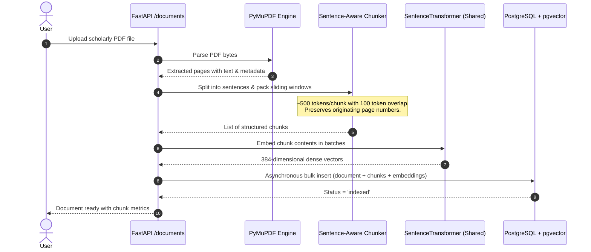
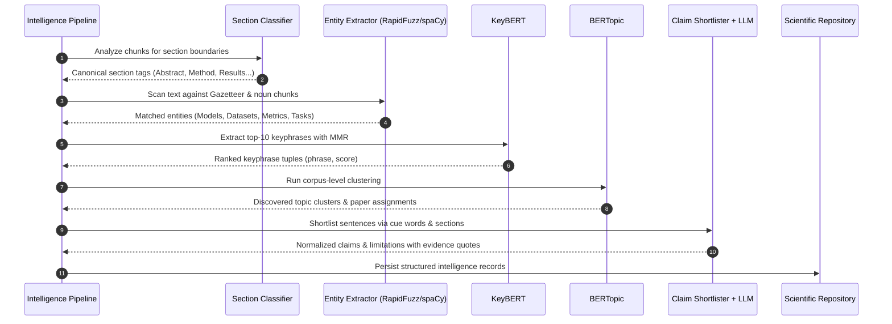
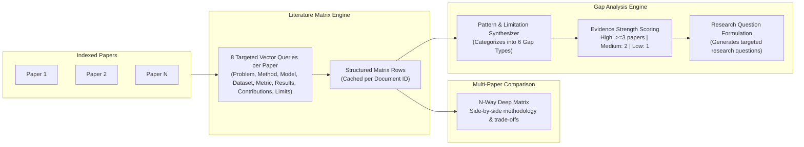
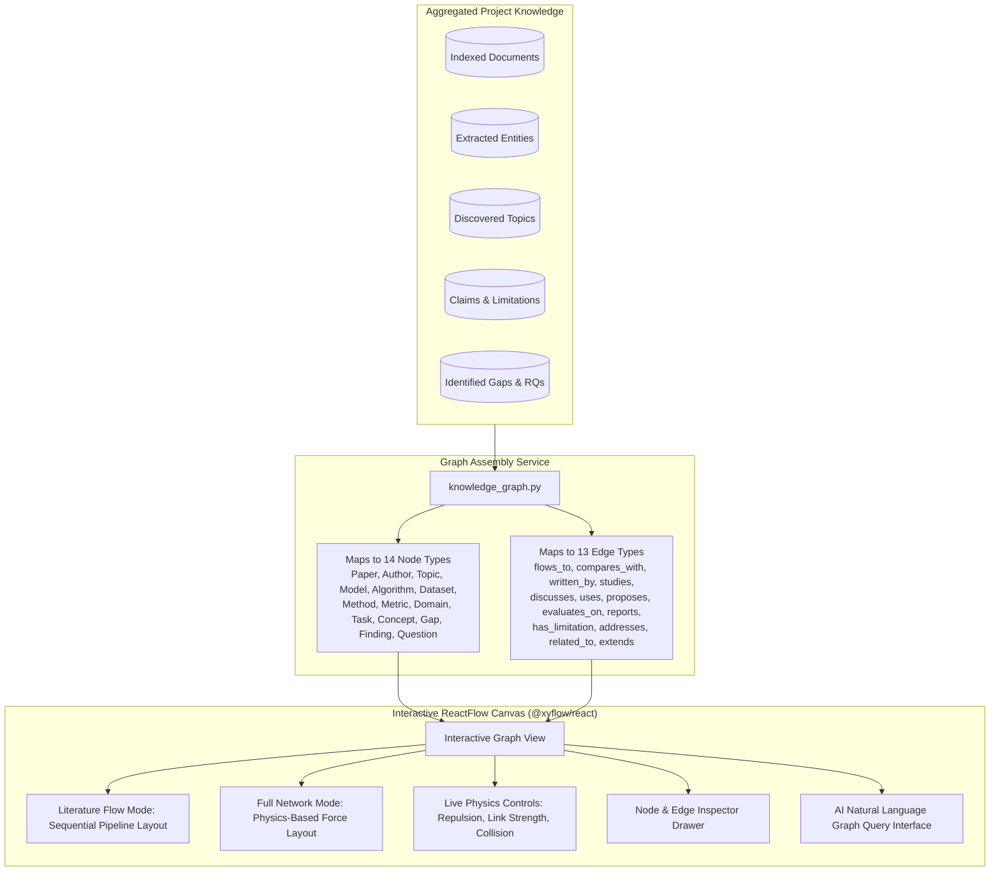
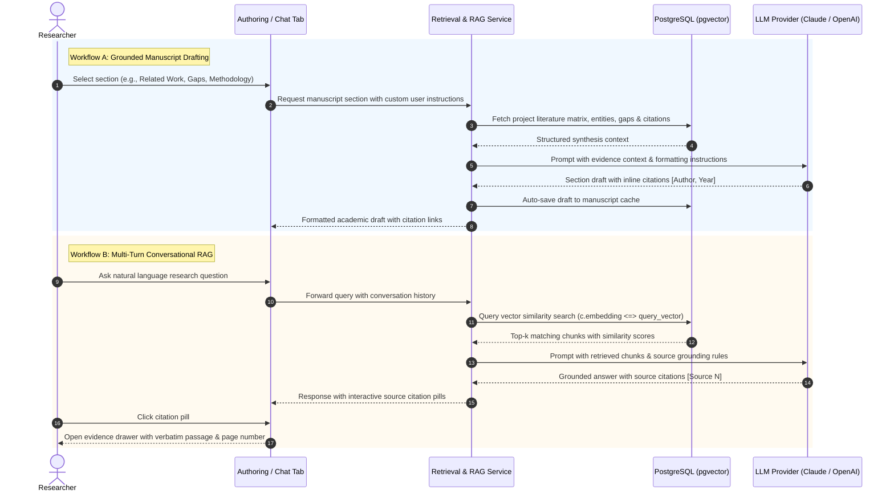
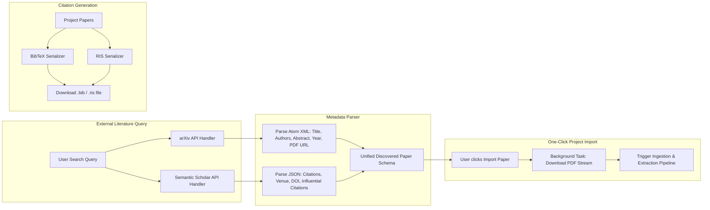

# 🔬 Research Nexus — Project Approach, Technology Stack & System Architecture

> **Comprehensive Technical Guide** detailing the design philosophy, complete technology stack, open-source machine learning models, end-to-end data pipelines, and execution flows powering the **Research Nexus** platform.

---

## 📑 Table of Contents

1. [Executive Summary](#1-executive-summary)
2. [Our Core Approach & Design Philosophy](#2-our-core-approach--design-philosophy)
   - [2.1 Evidence-Grounded Synthesis vs. Ungrounded Hallucination](#21-evidence-grounded-synthesis-vs-ungrounded-hallucination)
   - [2.2 Multi-Tier Hybrid AI Architecture](#22-multi-tier-hybrid-ai-architecture)
   - [2.3 Zero-Redundancy Shared Embeddings Architecture](#23-zero-redundancy-shared-embeddings-architecture)
   - [2.4 Strict Provenance & Bidirectional Traceability](#24-strict-provenance--bidirectional-traceability)
   - [2.5 Dual-Engine Operation (Production vs. Zero-Setup Demo)](#25-dual-engine-operation-production-vs-zero-setup-demo)
3. [Complete Technology Stack](#3-complete-technology-stack)
   - [3.1 Frontend Stack](#31-frontend-stack)
   - [3.2 Backend Stack](#32-backend-stack)
   - [3.3 Database & Vector Infrastructure](#33-database--vector-infrastructure)
   - [3.4 External Academic Integrations](#34-external-academic-integrations)
4. [Open-Source Machine Learning Models & NLP Technologies](#4-open-source-machine-learning-models--nlp-technologies)
   - [4.1 Dense Semantic Embeddings (`all-MiniLM-L6-v2`)](#41-dense-semantic-embeddings-all-minilm-l6-v2)
   - [4.2 Unsupervised Keyphrase Extraction (`KeyBERT`)](#42-unsupervised-keyphrase-extraction-keybert)
   - [4.3 Corpus-Level Topic Modeling (`BERTopic`)](#43-corpus-level-topic-modeling-bertopic)
   - [4.4 Scientific Entity Recognition (`RapidFuzz` + `spaCy`)](#44-scientific-entity-recognition-rapidfuzz--spacy)
   - [4.5 Scientific Section Classifier (Two-Tier Hybrid)](#45-scientific-section-classifier-two-tier-hybrid)
   - [4.6 Claim & Limitation Extraction (Deterministic Shortlisting + LLM Normalization)](#46-claim--limitation-extraction-deterministic-shortlisting--llm-normalization)
   - [4.7 PDF Processing & Ingestion (`PyMuPDF`)](#47-pdf-processing--ingestion-pymupdf)
   - [4.8 LLM Foundation Model Abstraction Layer](#48-llm-foundation-model-abstraction-layer)
   - [4.9 Summary Matrix of Open-Source Models & ML Libraries](#49-summary-matrix-of-open-source-models--ml-libraries)
5. [End-to-End System Flow & Pipelines](#5-end-to-end-system-flow--pipelines)
   - [5.1 High-Level Architecture Diagram](#51-high-level-architecture-diagram)
   - [5.2 Pipeline 1: PDF Ingestion, Chunking & Vectorization](#52-pipeline-1-pdf-ingestion-chunking--vectorization)
   - [5.3 Pipeline 2: Scientific Document Intelligence & Knowledge Extraction](#53-pipeline-2-scientific-document-intelligence--knowledge-extraction)
   - [5.4 Pipeline 3: Cross-Paper Synthesis & Research Intelligence](#54-pipeline-3-cross-paper-synthesis--research-intelligence)
   - [5.5 Pipeline 4: Interactive Visual Knowledge Graph & Physics Engine](#55-pipeline-4-interactive-visual-knowledge-graph--physics-engine)
   - [5.6 Pipeline 5: Grounded Manuscript Authoring & Multi-Turn RAG Chat](#56-pipeline-5-grounded-manuscript-authoring--multi-turn-rag-chat)
   - [5.7 Pipeline 6: External Literature Discovery & Citation Export](#57-pipeline-6-external-literature-discovery--citation-export)
6. [Architectural Highlights & Best Practices](#6-architectural-highlights--best-practices)

---

## 1. Executive Summary

**Research Nexus** is a full-stack research intelligence core and manuscript authoring platform designed for researchers, academics, and scientists. Instead of treating research literature as disconnected PDF files or relying on opaque conversational wrappers, Research Nexus converts scholarly corpora into a structured, queryable knowledge base.

The platform provides:
- Automated extraction of scientific entities (models, datasets, methods, metrics), empirical claims, and limitations.
- Multi-dimensional, side-by-side literature matrices with passage-level evidence grounding.
- Automated gap analysis identifying research bottlenecks, contradictions, and underexplored areas.
- Interactive, physics-simulated research knowledge graphs with 14 node types and 13 edge types.
- AI-assisted manuscript drafting (abstracts, introductions, related work, methodology comparisons, and conclusions) strictly anchored to ingested papers.
- Conversational RAG with inline citations and verbatim source evidence.

---

## 2. Our Core Approach & Design Philosophy

### 2.1 Evidence-Grounded Synthesis vs. Ungrounded Hallucination
Traditional LLM wrappers suffer from hallucinations when asked to "summarize this paper" or "find research gaps". Our architectural mandate is **Evidence First, Synthesis Second**:
- The platform **never passes an entire paper to an LLM** asking for open-ended summaries.
- Structured findings are extracted by retrieving passage candidates specific to targeted dimensions (e.g., dedicated vector queries for *methodology*, *datasets*, and *limitations*).
- Any assertion, matrix cell, or research gap is explicitly tethered to specific document IDs, page numbers, and chunk references.

### 2.2 Multi-Tier Hybrid AI Architecture
Rather than using a single monolithic foundation model for all tasks, the system implements a tiered separation of concerns:
1. **Deterministic / Rule-Based Layer**: Regex section pattern matchers, sentence splitters, and cue-word shortlisters handle structure and candidate generation with zero compute overhead and zero hallucination risk.
2. **Specialized Open-Source ML Layer**: Fast, reproducible, and explainable local models handle embeddings (`sentence-transformers`), keyphrase scoring (`KeyBERT`), clustering (`BERTopic`), and entity matching (`RapidFuzz` + `spaCy`).
3. **Selective LLM Normalization Layer**: Hosted LLMs (Claude or GPT-4o) are invoked only at the final step to normalize short candidate lists into structured JSON schemas or synthesize coherent prose from pre-extracted evidence.

### 2.3 Zero-Redundancy Shared Embeddings Architecture
Running multiple NLP models locally often leads to excessive GPU VRAM consumption and high CPU/RAM overhead. Research Nexus eliminates model duplication:
- A single instance of the dense embedding model (`sentence-transformers/all-MiniLM-L6-v2`) is loaded once into shared application memory.
- This same model instance serves:
  1. Dense vector indexing and similarity search in `pgvector`.
  2. Fallback semantic section classification for unlabelled document chunks.
  3. Candidate n-gram embedding and Maximal Marginal Relevance (MMR) ranking in `KeyBERT`.
  4. Document representation vectors for UMAP dimensionality reduction in `BERTopic`.
- **Outcome**: The entire scientific NLP extraction suite runs locally on a standard CPU with less than 1 GB of memory.

### 2.4 Strict Provenance & Bidirectional Traceability
Every entity, claim, limitation, and matrix cell preserves its provenance:
- Each item retains its originating `document_id`, `chunk_id`, `page_number`, and `evidence_text`.
- In the UI, clicking any citation badge or graph node immediately opens an evidence drawer displaying the exact textual passage and document metadata.

### 2.5 Dual-Engine Operation (Production vs. Zero-Setup Demo)
To ensure accessibility across development, evaluation, and production environments, the platform features two operation modes:
- **Production Mode**: Full async backend with FastAPI, PostgreSQL on Supabase with `pgvector`, and live Anthropic Claude / OpenAI APIs.
- **Offline Demo Mode**: Self-contained FastAPI mock server backed by a pre-computed JSON dataset (`fallback_demo.dat`). Provides 100% feature coverage without requiring API keys, Docker, or external network access.

---

## 3. Complete Technology Stack

```
┌────────────────────────────────────────────────────────────────────────┐
│                               FRONTEND                                 │
│  React 18 · Vite 6 · TailwindCSS 3 · @xyflow/react (ReactFlow 12)       │
│  Stateful Workspace with 12 Intelligent Feature Tabs                   │
└───────────────────────────────────┬────────────────────────────────────┘
                                    │ HTTP / REST (/api/*)
┌───────────────────────────────────▼────────────────────────────────────┐
│                            BACKEND (FASTAPI)                           │
│  Python 3.12 · FastAPI 0.115 · Uvicorn · Pydantic v2 · asyncpg 0.30     │
├───────────────────────────────────┬────────────────────────────────────┤
│         LOCAL ML SERVICES         │         RETRIEVAL & SYNTHESIS      │
│  • sentence-transformers (Embed)  │  • Sliding-Window Chunker          │
│  • KeyBERT (Keyphrases)           │  • Cosine Similarity RAG           │
│  • BERTopic (Topic Clusters)      │  • Multi-Paper Comparison Engine   │
│  • RapidFuzz + spaCy (Entities)   │  • Gap Analysis & Matrix Engine    │
│  • PyMuPDF (PDF Parser)           │  • LLM Provider (Claude / OpenAI)  │
└───────────────────────────────────┬────────────────────────────────────┘
                                    │
┌───────────────────────────────────▼────────────────────────────────────┐
│                    SUPABASE (POSTGRESQL + PGVECTOR)                    │
│  pgvector (384-dim vector cosine distance <=> search)                  │
│  Relational schemas for Projects, Documents, Chunks, Sections,        │
│  Entities, Claims, Limitations, Topics, and Graph Topologies           │
└────────────────────────────────────────────────────────────────────────┘
```

### 3.1 Frontend Stack

| Technology | Version | Purpose & Implementation Details |
| :--- | :--- | :--- |
| **React** | `18.3.1` | Core declarative component architecture and reactive UI state management. |
| **Vite** | `6.0.7` | Next-generation frontend build tool providing fast Hot Module Replacement (HMR) and optimized build bundles. |
| **@xyflow/react** | `12.12.0` | ReactFlow library powering the interactive Visual Knowledge Graph with custom nodes, typed edges, minimap, and physics controls. |
| **TailwindCSS** | `3.4.17` | Utility-first CSS framework for clean styling, responsive layouts, and unified color palettes. |
| **Custom API Client** | Custom | Custom `fetch`-based API layer (`api.js`) providing automated demo-mode switching, error resilience, and standardized payloads. |

### 3.2 Backend Stack

| Technology | Version | Purpose & Implementation Details |
| :--- | :--- | :--- |
| **Python** | `3.12+` | Modern asynchronous runtime utilizing strict type annotations and pattern matching. |
| **FastAPI** | `0.115.6` | High-performance asynchronous web framework providing automatic OpenAPI documentation, dependency injection, and lifespan events. |
| **Uvicorn** | `0.34.0` | Asynchronous Server Gateway Interface (ASGI) web server. |
| **Pydantic / Pydantic-Settings** | `2.10.4` / `2.7.1` | Request/response schema validation and environment variable configuration management. |
| **asyncpg** | `0.30.0` | High-speed, non-blocking PostgreSQL client utilizing native binary protocol communication. |
| **httpx** | `0.28+` | Asynchronous HTTP client for querying external preprint and academic APIs. |

### 3.3 Database & Vector Infrastructure

| Technology | Version / Type | Purpose & Implementation Details |
| :--- | :--- | :--- |
| **PostgreSQL** | `15+` (Supabase) | Primary relational database maintaining referential integrity across projects, documents, chunks, and metadata. |
| **pgvector** | Extension | Vector extension enabling storage of dense embeddings (`vector(384)`) and cosine distance search (`<=>` operator). |
| **SQL Migrations** | 5 Iterative Scripts | Modular schema migrations handling core RAG tables, literature intelligence caches, scientific knowledge entities, and auto-save state. |

### 3.4 External Academic Integrations

| Provider | Protocol | Capabilities |
| :--- | :--- | :--- |
| **arXiv API** | REST / Atom XML | Real-time querying of open-access preprints by keyword, author, or category; extracts title, abstract, authors, and PDF links. |
| **Semantic Scholar API** | REST JSON | Access to 200M+ academic publications; fetches citation counts, publication years, venues, and DOI identifiers. |

---

## 4. Open-Source Machine Learning Models & NLP Technologies

Research Nexus is built with a strong focus on open-source, local-first ML models that eliminate external API dependencies for knowledge extraction tasks.

### 4.1 Dense Semantic Embeddings (`all-MiniLM-L6-v2`)

```
Input Text ──► [ BERT Backbone (6 Layers, 384 Hidden Dim) ] ──► [ Mean Pooling ] ──► [ L2 Normalization ] ──► 384-dim Vector
```

- **Model Checkpoint**: `sentence-transformers/all-MiniLM-L6-v2`
- **Library**: `sentence-transformers 3.3.1`
- **Repository**: [Hugging Face Hub](https://huggingface.co/sentence-transformers/all-MiniLM-L6-v2)
- **License**: Apache-2.0
- **Technical Mechanism**:
  - Distilled 6-layer BERT architecture trained on over 1 billion sentence pairs using self-supervised contrastive learning.
  - Maps sentences and paragraphs into a dense 384-dimensional continuous vector space.
  - Generates token representations followed by mean pooling over the token sequence and L2 normalization.
- **Why Chosen**:
  - Extremely compact (~80 MB model weights) and executes efficiently on modern CPUs without requiring dedicated GPUs.
  - Achieves competitive semantic retrieval benchmark performance (MTEB) while being ~5x faster than standard BERT base models.
  - Serves as the single shared embedding backbone for the entire platform.
- **Supported Alternatives**: The architecture is fully modular via `.env` configuration, supporting `BAAI/bge-small-en-v1.5`, `allenai/specter2` (768-dim), and `malteos/scincl`.

---

### 4.2 Unsupervised Keyphrase Extraction (`KeyBERT`)

```
Document Text ──► [ N-gram Candidate Generation (1-3 words) ]
                       │
                       ├── Candidate Embeddings ──┐
                       │                          ▼
Document Embedding ────┴─────────────────► [ Cosine Similarity + MMR ] ──► Top-N Diverse Keyphrases
```

- **Library**: `keybert 0.8.5`
- **Algorithm Author**: Maarten Grootendorst
- **Repository**: [GitHub - MaartenGr/KeyBERT](https://github.com/MaartenGr/KeyBERT)
- **License**: MIT
- **Technical Mechanism**:
  - Extracts n-gram candidates (1 to 3 words) from document text using scikit-learn count vectorizers.
  - Generates embeddings for candidate n-grams and computes cosine similarity against the whole-document embedding vector.
  - Applies **Maximal Marginal Relevance (MMR)** to balance relevance to the document against diversity among chosen keyphrases, preventing redundant variations of the same term.
- **Why Chosen**:
  - Does not require a separate neural network; it is an embedding-based extraction algorithm that directly reuses the pre-loaded `all-MiniLM-L6-v2` model.
  - Eliminates the need for handcrafted TF-IDF heuristics or generic stop-word filters.
  - Produces continuous confidence scores in the range `[0.0, 1.0]`.

---

### 4.3 Corpus-Level Topic Modeling (`BERTopic`)

```
Document Texts (Abstracts + Keyphrases)
       │
       ▼
[ Shared SentenceTransformer Embeddings ]
       │
       ▼
[ UMAP Dimensionality Reduction ]  (Projects high-dim vectors into low-dim space)
       │
       ▼
[ HDBSCAN Clustering ]             (Identifies dense clusters, isolates outliers)
       │
       ▼
[ c-TF-IDF Topic Representation ]  (Extracts distinctive terms per cluster)
       │
       ▼
Cluster Labels & Topic Keywords
```

- **Library**: `bertopic 0.16.4`
- **Algorithm Author**: Maarten Grootendorst
- **Repository**: [GitHub - MaartenGr/BERTopic](https://github.com/MaartenGr/BERTopic)
- **License**: MIT
- **Technical Mechanism**:
  - Employs a modular pipeline:
    1. **Embeddings**: Uses the shared `all-MiniLM-L6-v2` model to embed paper abstracts and keyphrases.
    2. **Dimensionality Reduction**: Uses UMAP to reduce vector dimensionality while preserving local and global manifold structures.
    3. **Density Clustering**: Uses HDBSCAN to find clusters of arbitrary shapes without requiring the number of clusters to be specified beforehand.
    4. **Representation**: Calculates class-based TF-IDF (`c-TF-IDF`) to determine which words best characterize each cluster.
- **Why Chosen**:
  - Generates coherent, interpretable topic clusters through unsupervised learning without requiring LLM prompting.
  - Reuses the shared embedding model, avoiding duplicate model downloads.
  - Configured with small-corpus protections (`min_topic_size=2`), enabling it to identify meaningful topics even on small 5–10 paper collections.

---

### 4.4 Scientific Entity Recognition (`RapidFuzz` + `spaCy`)

```
Document Chunk Text
       │
       ├──► [ Pass 1: Curated Scientific Gazetteer + RapidFuzz ]
       │         • Exact & Fuzzy Matching (Levenshtein / Ratio)
       │         • Matches Models, Datasets, Methods, Metrics, Domains, Tasks
       │         • Produces high-confidence normalized entities
       │
       └──► [ Pass 2: spaCy en_core_web_sm Pipeline (Optional) ]
                 • Part-of-Speech Tagging & Dependency Parsing
                 • Extracts candidate noun-chunks for novel terminology
                 • Flags candidates for downstream inspection
```

- **Libraries**:
  - `rapidfuzz 3.11.0` (C++ core fuzzy matching engine, MIT License)
  - `spacy 3.8.2` with `en_core_web_sm` model (~13 MB CPU pipeline, MIT / Apache-2.0 License)
- **Technical Mechanism**:
  - **Pass 1 (Gazetteer Matching)**: Scans text against a curated dictionary of scientific entities spanning 6 canonical types (`model`, `dataset`, `method`, `metric`, `domain`, `task`). Uses C++-accelerated string metric ratios to handle OCR artifacts, hyphens, and spelling variants (e.g., mapping `"Res Net-50"` and `"resnet50"` to `"ResNet-50"`).
  - **Pass 2 (Syntactic Noun Chunking)**: Uses spaCy's lightweight dependency parser to identify multi-word noun phrases representing novel methods or techniques not yet cataloged in the gazetteer.
- **Why Chosen**:
  - Avoids common pitfalls of large scientific NER models (such as SciBERT NER checkpoints), which often lack maintained pip packages, exhibit fragile tokenizer dependencies, or only output coarse tags (e.g., generic `MATERIAL` or `TERM`).
  - Delivers fast, deterministic extraction with exact character offsets and verifiable confidence scores.

---

### 4.5 Scientific Section Classifier (Two-Tier Hybrid)

```
Document Text Block / Chunk
       │
       ├──► [ Tier 1: Regex Heading Pattern Matcher ]
       │         • Tests for structural headings ("Abstract", "Methodology", "Results", etc.)
       │         • Maps to 12 canonical labels via synonym dictionary
       │         • Deterministic, zero compute overhead
       │
       └──► [ If No Heading Detected -> Tier 2: Embedding Cosine Classifier ]
                 • Embeds chunk with shared all-MiniLM-L6-v2
                 • Calculates cosine similarity against canonical section definition embeddings
                 • Assigns best matching section if similarity >= confidence threshold
```

- **Implementation**: Custom hybrid classifier (`app.services.ml.section_classifier`)
- **Underlying Models**: Shared `sentence-transformers/all-MiniLM-L6-v2`
- **Canonical Section Vocabulary (12 Classes)**:
  `title`, `abstract`, `introduction`, `related_work`, `methodology`, `dataset`, `experiments`, `results`, `discussion`, `conclusion`, `limitations`, `future_work`
- **Technical Mechanism**:
  - **Tier 1 (Heading Matching)**: Identifies section headings using layout patterns and maps them through a synonym dictionary (e.g., mapping `"Experimental Setup"`, `"Evaluation"`, and `"Empirical Results"` to canonical labels).
  - **Tier 2 (Semantic Cosine Matching)**: If a chunk lacks explicit headings, it is embedded using the shared SentenceTransformer and compared against pre-computed embeddings of canonical section definitions. The winning class is assigned with its real cosine similarity score.
- **Why Chosen**:
  - Publicly available scientific section classification models are typically trained on biomedical abstracts (such as PubMed-RCT) rather than full-text computer science papers.
  - This two-tier approach delivers high accuracy across diverse paper layouts without requiring custom model fine-tuning.

---

### 4.6 Claim & Limitation Extraction (Deterministic Shortlisting + LLM Normalization)

```
Classified Paper Chunks
       │
       ▼
[ Deterministic Sentence Shortlisting ]
  • Claims: Filter sentences from RESULTS / DISCUSSION / CONCLUSION containing numbers, %,
    or comparative cue words ("achieves", "outperforms", "improves", "demonstrates").
  • Limitations: Filter sentences from LIMITATIONS / DISCUSSION / FUTURE_WORK containing
    hedging cue words ("limitation", "however", "constrained by", "does not generalize").
       │
       ▼
[ Bounded Candidate List (Capped per paper) ]
       │
       ▼
[ LLM Provider Normalization ]
  • Prompt receives ONLY the shortlisted sentences (LLM never sees or summarizes raw PDF).
  • Normalizes text into clean factual assertions with structured types.
  • Output preserves original sentence as evidence_text for provenance.
```

- **Libraries**: Regex tokenization + Configured LLM Provider (`Anthropic` / `OpenAI` / `Mock`)
- **Technical Mechanism**:
  - Filters candidate sentences based on section labels and lexical cues (such as numerical figures, percentage signs, and comparative verbs).
  - Passes only the shortlisted candidates to the LLM for normalization into a structured JSON schema.
- **Why Chosen**:
  - Prevents the hallucination risks common with open-ended "summarize the findings" prompts.
  - Ensures every extracted claim is directly traceable to a verifiable sentence in the source PDF.

---

### 4.7 PDF Processing & Ingestion (`PyMuPDF`)

- **Library**: `PyMuPDF 1.25.1` (`fitz`)
- **Repository**: [GitHub - pymupdf/PyMuPDF](https://github.com/pymupdf/PyMuPDF)
- **License**: AGPL-3.0 / Commercial
- **Technical Mechanism**:
  - High-performance C-based rendering and PDF extraction library.
  - Parses PDFs page-by-page, extracting clean text streams, handling multi-column layouts, and extracting document metadata (title, author, creation date).
- **Why Chosen**:
  - Significantly faster than pure-Python parsers (e.g., PyPDF2 or pypdf).
  - Preserves exact page numbers, which is essential for accurate citation referencing.

---

### 4.8 LLM Foundation Model Abstraction Layer

- **Module**: `app.services.llm_provider`
- **Supported Backends**:
  1. **Anthropic Claude**: `claude-sonnet-4-6` / `claude-3-7-sonnet` (via `anthropic 0.42.0`)
  2. **OpenAI**: `gpt-4o` / `gpt-4-turbo` (via `openai 1.58.1`)
  3. **Mock Provider**: Offline deterministic fallback used for testing and local demonstrations.
- **Design Pattern**: Abstract Provider Interface decoupling application business logic from specific proprietary APIs, allowing seamless switching via environment variables.

---

### 4.9 Summary Matrix of Open-Source Models & ML Libraries

| Model / Library | Version | License | Host / Execution | Role in Research Nexus | Primary Advantage |
| :--- | :--- | :--- | :--- | :--- | :--- |
| **`sentence-transformers`** (`all-MiniLM-L6-v2`) | `3.3.1` | Apache-2.0 | Local (CPU / GPU) | Dense vector embeddings, retrieval, section classification | ~80MB, fast CPU inference, shared across services |
| **`KeyBERT`** | `0.8.5` | MIT | Local (CPU) | Unsupervised keyphrase extraction via MMR | Reuses shared embeddings; avoids TF-IDF heuristics |
| **`BERTopic`** | `0.16.4` | MIT | Local (CPU) | Topic discovery via UMAP + HDBSCAN + c-TF-IDF | Unsupervised topic clustering across paper corpora |
| **`rapidfuzz`** | `3.11.0` | MIT | Local (C++ Core) | High-speed fuzzy string matching against gazetteers | Handles OCR noise and spelling variations efficiently |
| **`spaCy`** (`en_core_web_sm`) | `3.8.2` | MIT / Apache-2.0 | Local (CPU, ~13MB) | Syntactic noun-chunk candidate extraction | Discovers domain terms outside the gazetteer |
| **`PyMuPDF`** (`fitz`) | `1.25.1` | AGPL-3.0 | Local (C Core) | Text extraction and per-page layout parsing | High parsing speed with page-accurate offsets |
| **`pgvector`** | Extension | PostgreSQL | Database Server | Vector indexing and cosine similarity search (`<=>`) | Native database vector operations alongside relational data |

---

## 5. End-to-End System Flow & Pipelines

### 5.1 High-Level Architecture Diagram

```mermaid
flowchart TD
    subgraph INGESTION["1. Document Ingestion & Vector Indexing"]
        A[User Uploads PDF] --> B[PyMuPDF Parser]
        B --> C[Page-Aware Sentence Splitter]
        C --> D[Sliding Window Chunker (~500 tokens, 100 overlap)]
        D --> E[Shared SentenceTransformer all-MiniLM-L6-v2]
        E --> F[(Supabase PostgreSQL + pgvector)]
    end

    subgraph INTELLIGENCE["2. Scientific Document Intelligence"]
        D --> G[Section Classifier: Heading Regex + Embedding Cosine]
        D --> H[Entity Extraction: RapidFuzz Gazetteer + spaCy Noun Chunks]
        D --> I[Keyphrase Extraction: KeyBERT + MMR]
        D --> J[Topic Modeling: BERTopic on Project Corpus]
        D --> K[Claim & Limitation Filter: Cue Words + Regex]
        K --> L[LLM Normalization to Structured JSON]
        G & H & I & J & L --> M[(Relational Intelligence Tables)]
    end

    subgraph SYNTHESIS["3. Research Synthesis Engines"]
        M --> N[Literature Matrix: 8-Dimension Vector Retrieval]
        M --> O[Multi-Paper Deep Comparison Engine]
        M --> P[Gap Analysis: 6 Categories + Evidence Strength]
        P --> Q[Targeted Research Questions Generator]
    end

    subgraph VISUALIZATION["4. Interactive Visual Knowledge Graph"]
        M & N & P --> R[Knowledge Graph Generator]
        R --> S["ReactFlow Graph: 14 Node Types & 13 Edge Types"]
        S --> T[Physics Engine & AI Graph Query Assistant]
    end

    subgraph OUTPUTS["5. Manuscript Authoring & RAG Chat"]
        N & P & M --> U[AI Manuscript Authoring: 6 Academic Sections]
        F & M --> V[Multi-Turn Conversational RAG with Citations]
        U & V --> W[Export: Markdown, BibTeX, RIS]
    end
```

---

### 5.2 Pipeline 1: PDF Ingestion, Chunking & Vectorization



1. **PDF Extraction**: `PyMuPDF` reads document streams, parsing text while preserving page numbers and document metadata.
2. **Sentence Segmentation**: Text is segmented using punctuation regex rules (`(?<=[.!?])\s+(?=[A-Z0-9])`), ensuring chunks break only at sentence boundaries.
3. **Sliding Window Chunking**: Sentences are grouped into chunks of approximately 500 tokens with a 100-token overlap between consecutive chunks to maintain context across boundaries.
4. **Vector Embedding**: The shared `all-MiniLM-L6-v2` model embeds chunks in batches into 384-dimensional dense float arrays.
5. **Storage**: `asyncpg` writes the document record and chunks to PostgreSQL. Embeddings are stored in a `vector(384)` column for similarity search.

---

### 5.3 Pipeline 2: Scientific Document Intelligence & Knowledge Extraction



1. **Section Classification**: Chunks are mapped to 12 canonical section labels using heading regex patterns, falling back to embedding cosine similarity for unlabelled blocks.
2. **Entity Extraction**: The gazetteer identifies domain entities using `RapidFuzz` string matching, while `spaCy` surfaces candidate noun-chunks for novel terminology.
3. **Keyphrase Extraction**: `KeyBERT` extracts diverse 1-to-3 word keyphrases from each paper using Maximal Marginal Relevance.
4. **Topic Modeling**: `BERTopic` clusters document representations across the project corpus, generating cluster labels and assigning papers via `c-TF-IDF`.
5. **Claim & Limitation Extraction**: Rule-based filters shortlist candidate sentences containing numbers, percentages, or cue words, which the LLM then normalizes into structured JSON records.

---

### 5.4 Pipeline 3: Cross-Paper Synthesis & Research Intelligence



1. **Literature Matrix**: Executes 8 targeted vector retrieval queries per paper (one for each matrix dimension) to gather focused evidence passages, which are synthesized into structured matrix rows and cached by document ID.
2. **Multi-Paper Comparison**: Compares multiple selected papers side-by-side across methodologies, datasets, performance results, and trade-offs.
3. **Gap Analysis**: Synthesizes limitations, methodologies, and datasets across the paper corpus into 6 categories:
   - `repeated_limitation`: Unresolved constraints appearing across multiple papers.
   - `underexplored_area`: Relevant problem formulations with limited existing work.
   - `methodological`: Architectural shortcomings or missing baselines.
   - `dataset`: Small sample sizes, lack of diversity, or missing benchmarks.
   - `evaluation`: Incomplete evaluation metrics or non-standard protocols.
   - `contradiction`: Conflicting findings or claims between papers.
4. **Evidence Strength Scoring**: Scores gap reliability based on supporting paper counts (High: $\ge 3$, Medium: $2$, Low: $1$).
5. **Research Questions**: Generates actionable research questions directly addressing the identified gaps.

---

### 5.5 Pipeline 4: Interactive Visual Knowledge Graph & Physics Engine



1. **Graph Assembly**: Collects entities, topics, claims, limitations, gaps, and papers for a project, structuring them into a node-link schema.
2. **Node Typing (14 Types)**: Categorizes nodes into distinct types (Paper, Author, Topic, Model, Algorithm, Dataset, Method, Metric, Domain, Task, Concept, Gap, Finding, Question) with dedicated visual styling.
3. **Edge Typing (13 Types)**: Establishes semantic relationships between nodes (e.g., `proposes`, `evaluates_on`, `has_limitation`, `addresses`).
4. **Dual Layout Views**:
   - **Literature Flow**: Arranges papers and methodologies in a sequential pipeline view.
   - **Full Network**: Displays an interactive force-directed graph layout.
5. **Interactive Controls**: Features live physics tuning (repulsion, link strength, collision radius), node search, filtering, and a natural language query interface (e.g., *"Which models are evaluated on MIMIC-III?"*).

---

### 5.6 Pipeline 5: Grounded Manuscript Authoring & Multi-Turn RAG Chat



#### Manuscript Authoring Engine
- Provides drafting assistance across 6 academic section types:
  1. **Abstract**: Synthesizes research motivations, methodologies, benchmarks, and key findings into a ~250-word overview.
  2. **Introduction**: Formulates problem domains, technical challenges, motivations, and contribution summaries.
  3. **Related Work**: Groups analyzed papers by methodology and dataset themes with formal citations.
  4. **Methodology Comparison**: Compares algorithms, architectures, loss functions, and evaluation metrics across papers.
  5. **Research Gaps**: Synthesizes open challenges and formulates specific research questions.
  6. **Conclusion**: Summarizes synthesized insights and outlines future research directions.
- All drafts are grounded in pre-extracted evidence matrices rather than open-ended prompting, and are saved automatically to the database.

#### Conversational RAG Assistant
- Maintains multi-turn conversation history per project.
- Retrieves relevant document chunks using `pgvector` cosine similarity search.
- Constructs grounded prompts instructing the LLM to answer using only the provided context and cite specific source passages.
- Displays interactive citation badges in the UI that open the source passage and document metadata when clicked.

---

### 5.7 Pipeline 6: External Literature Discovery & Citation Export



1. **Literature Discovery**: Queries the arXiv and Semantic Scholar APIs in parallel, normalizing results into a unified metadata schema including titles, authors, venues, publication years, abstracts, and citation counts.
2. **One-Click Ingestion**: Downloading a discovered paper triggers the background ingestion pipeline (`PyMuPDF` parsing, sliding-window chunking, vector embedding, and knowledge extraction) into the active project.
3. **Citation Export**: Formats project bibliography data into standardized BibTeX (`.bib`) and RIS (`.ris`) files compatible with reference managers such as Zotero, Mendeley, and EndNote.

---

## 6. Architectural Highlights & Best Practices

| Design Dimension | Implementation in Research Nexus | Architectural Benefit |
| :--- | :--- | :--- |
| **Model Weight Sharing** | The in-memory `all-MiniLM-L6-v2` instance is shared across retrieval, `KeyBERT`, `BERTopic`, and section classification fallback. | Low memory footprint (<1GB RAM); runs on standard CPUs without GPU dependencies. |
| **Ungrounded Hallucination Prevention** | Extraction pipelines shortlist candidate sentences deterministically before invoking LLMs. | Eliminates fabricated claims; ensures every finding has verifiable textual provenance. |
| **Dimension-Specific Vector Retrieval** | The literature matrix uses 8 distinct vector queries per paper rather than a single broad query. | High extraction precision; prevents methodology details from crowding out limitations or metrics. |
| **Graph Visual Performance** | Built with `@xyflow/react` and includes real-time physics controls (repulsion, link strength, collision). | Smooth graph interaction with 14 node types and 13 edge types. |
| **Reproducible Offline Demonstrations** | Offline mode is supported via a standalone FastAPI mock server and serialized dataset (`fallback_demo.dat`). | Full feature availability for local evaluation without cloud services or API keys. |
| **Modular Provider Architecture** | Clean abstraction interfaces decouple business logic from underlying LLM and embedding providers. | Allows switching between Anthropic, OpenAI, local models, or mock providers via configuration. |

---

*Document compiled for the Research Nexus architecture codebase.*
